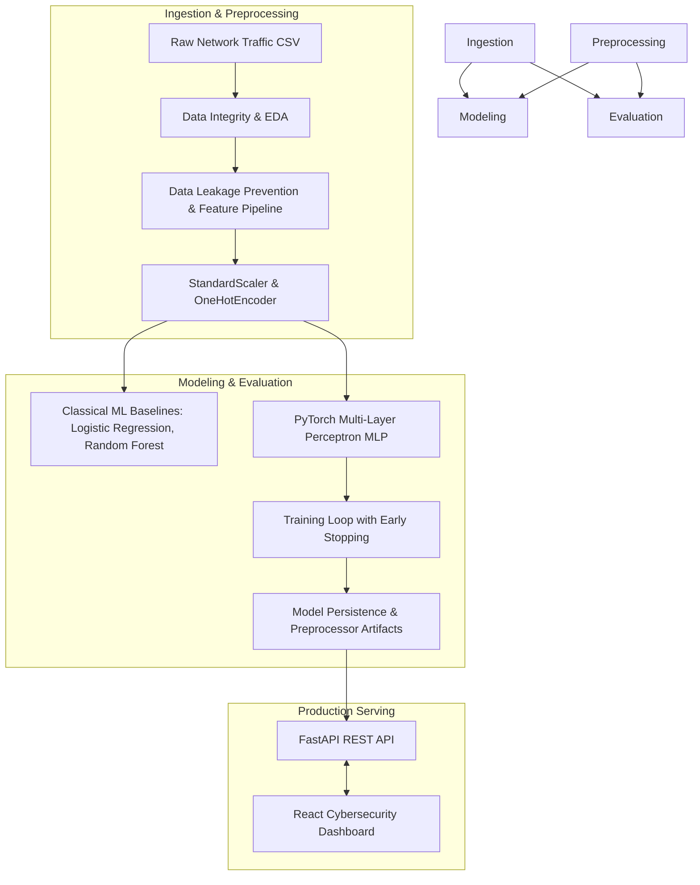

# 🛡️ AI-Powered Network Intrusion Detection System (NIDS)


An end-to-end, production-grade Deep Learning system that classifies network traffic flow data in real-time, identifying benign activity versus 9 distinct cyber-attack categories using **PyTorch**, **Scikit-Learn**, **FastAPI**, and **React**.

---

## 📌 Problem Statement & Motivation

Modern enterprise networks face thousands of malicious cyber probes every second. Traditional signature-based detection systems fail against zero-day exploits. This project demonstrates an **AI-driven Network Intrusion Detection System (NIDS)** trained on the **UNSW-NB15** benchmark dataset to classify 10 distinct network traffic categories:

* **Normal Traffic**
* **Attacks:** Fuzzers, Analysis, Backdoors, DoS, Exploits, Generic, Reconnaissance, Shellcode, and Worms.

---

## 🏗️ System Architecture & Data Flow



---

## 🚀 Key Engineering & Machine Learning Highlights

1. **Strict Data Leakage Prevention:** All scalers (`StandardScaler`) and categorical encoders (`OneHotEncoder`) are fitted **strictly on the training split**. Test data and production API inputs are transformed using the saved preprocessor pipeline object.
2. **Handling Extreme Class Imbalance:** Network intrusion datasets are naturally imbalanced (e.g., thousands of normal records vs. very few backdoor packets). Evaluation focuses on **Macro F1-Score** and **Recall** rather than raw accuracy.
3. **Device-Independent & CPU-Optimized:** Designed for efficient local execution without requiring a GPU, while supporting CUDA execution seamlessly if trained on Google Colab/Kaggle.
4. **Full-Stack Integration:** Includes a low-latency **FastAPI** backend for microsecond inference and a modern **React** cybersecurity dashboard.

---

## 📊 Benchmark Results Summary

| Model | Accuracy | Macro Recall | Macro F1-Score | Weighted F1-Score | Status |
| :--- | :---: | :---: | :---: | :---: | :---: |
| **Logistic Regression** | 69.84% | 38.42% | 0.3359 | 0.7062 | Baseline |
| **Random Forest Classifier** | *Training...* | *Training...* | *Training...* | *Training...* | Benchmark |
| **PyTorch Deep MLP** | *Next Phase* | *Next Phase* | *Next Phase* | *Next Phase* | Primary Model |

> **Key Takeaway for Interviewers:** Notice how Logistic Regression achieves 69.84% accuracy, yet its Macro F1 is only 0.3359. This highlights why standard accuracy is misleading for cybersecurity intrusion detection and why deep feature learning is necessary.

---

## 📂 Project Structure

```text
ai_nids/
├── data/
│   ├── raw/                # UNSW-NB15 CSV datasets
│   └── processed/          # Preprocessed Numpy arrays
├── notebooks/
│   └── plots/              # Saved EDA visualizations & confusion matrices
├── src/
│   ├── data/
│   │   ├── download_data.py  # Dataset downloader & offline synthetic generator
│   │   ├── eda.py            # Missing value, duplicate & distribution analysis
│   │   └── preprocess.py     # Leakage-free feature scaling & encoding pipeline
│   ├── models/
│   │   ├── baselines.py      # Logistic Regression & Random Forest benchmarks
│   │   └── network.py        # PyTorch Multi-Layer Perceptron architecture
│   ├── training/             # PyTorch training loops, loss functions & metrics
│   ├── evaluation/           # Evaluation metrics & confusion matrix generators
│   └── utils/                # Logging & utility scripts
├── api/                      # FastAPI REST inference microservice
├── frontend/                 # React (Vite) Cybersecurity Dashboard UI
├── models/                   # Saved PyTorch weights (.pt) & preprocessors (.pkl)
├── requirements.txt          # Python dependencies
├── README.md                 # Project documentation
└── .gitignore                # Environment & dataset exclusions
```

---

## ⚡ Quickstart Guide

### 1. Clone & Setup Environment
```bash
git clone https://github.com/Shaamak/AI-NIDS.git
cd AI-NIDS

# Create virtual environment
python -m venv .venv
# On Windows:
.\.venv\Scripts\Activate.ps1
# On Linux/macOS:
# source .venv/bin/activate

pip install -r requirements.txt
```

### 2. Run Data Pipeline & Baselines
```bash
# Download raw dataset (with offline fallback support)
python src/data/download_data.py

# Run Exploratory Data Analysis
python src/data/eda.py

# Run Preprocessing & Feature Pipeline
python src/data/preprocess.py

# Evaluate ML Baselines
python src/models/baselines.py
```

---

## 🛠️ Tech Stack & Tools

* **Machine Learning & Deep Learning:** PyTorch, Scikit-Learn, Pandas, NumPy
* **Data Visualization:** Matplotlib, Seaborn
* **API Microservice:** FastAPI, Uvicorn, Pydantic
* **Frontend:** React, Vite
* **Version Control & Quality:** Git, Pytest

---

## 📝 License
This project is licensed under the [MIT License](LICENSE).
